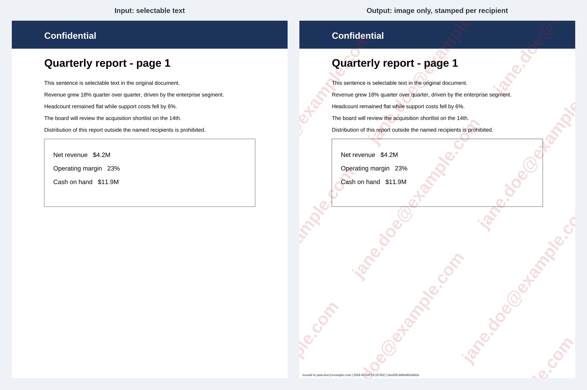
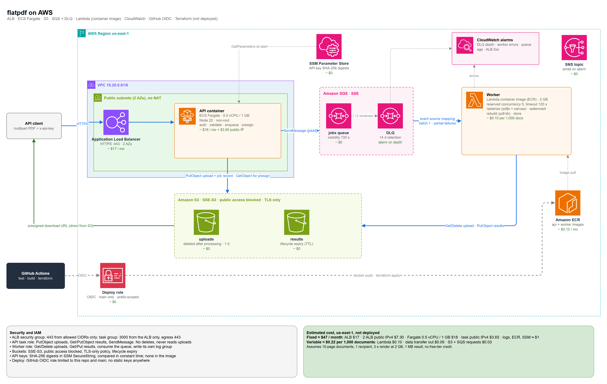
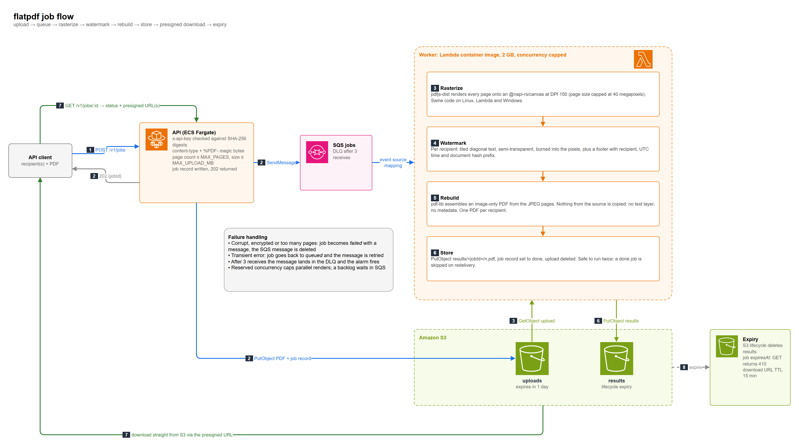
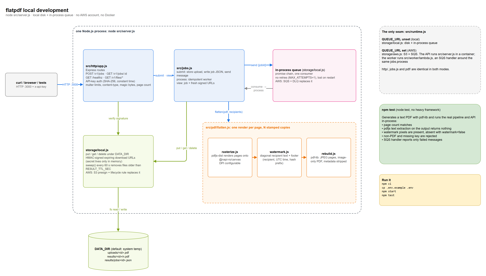

# flatpdf

Flatten PDFs into image-only copies with per-recipient watermarks: text can't be copied, and every leaked copy is traceable.


[](https://github.com/andresazcona/flatpdf/actions/workflows/ci.yml)



Left: the input, with real text. Right: the output for one recipient. Every page is an image, carries a diagonal stamp and a footer with the recipient, a UTC timestamp and the source-document hash prefix. Regenerate with `npm run demo:images`.



## Why

- **Copy prevention.** Sending a PDF to a customer, auditor or candidate usually means they can select, copy and paste it. A flattened copy has no text layer, no metadata, no form fields and no embedded files.
- **Leak traceability.** Each recipient gets their own copy with their identifier burned into every page, and the API returns a SHA-256 of each output. When a document shows up somewhere it should not, you know whose copy it was.

Honest limits: this is a deterrent, not DRM. Someone can still screenshot a page or run OCR on it. The watermark is what discourages that, because the leak points back to them. If the recipient must never be able to keep a copy, a viewer-side control is the right tool, not a file.

## Quick start

Requires Node.js 20.19 or newer. No AWS account, no Docker, no native toolchain: rasterizing uses `pdfjs-dist` and `@napi-rs/canvas`, which ship prebuilt binaries for Linux, macOS and Windows.

```bash
npm ci
cp .env.example .env          # includes the key "dev-key-change-me" (hash only)
npm start                     # http://localhost:3000
```

```bash
# Submit a PDF for two recipients
curl -s -H "x-api-key: dev-key-change-me" \
  -F file=@report.pdf \
  -F recipient=alice@example.com -F recipient=bob@example.com \
  http://localhost:3000/v1/jobs
# {"jobId":"4f1c2a8e-6b0d-4f0e-9a43-0c5b8d9a7e21","status":"queued"}

# Poll until status is "done": one expiring download URL per recipient
curl -s -H "x-api-key: dev-key-change-me" \
  http://localhost:3000/v1/jobs/4f1c2a8e-6b0d-4f0e-9a43-0c5b8d9a7e21

# One clean flattened copy, no watermark
curl -s -H "x-api-key: dev-key-change-me" -F file=@report.pdf -F watermark=false \
  http://localhost:3000/v1/jobs
```

Make your own key: `node -e "console.log(require('crypto').createHash('sha256').update('YOUR_KEY').digest('hex'))"` and put the digest in `API_KEY_SHA256` (comma-separated for several keys). The server never holds a usable key.

The full contract is in [`openapi.yaml`](openapi.yaml): `POST /v1/jobs`, `GET /v1/jobs/{id}`, `GET /healthz`.

```bash
npm test        # node:test: pipeline, API, SQS handler
npm run lint
```

## How a job flows



1. `POST /v1/jobs`: API key, content type, `%PDF-` magic bytes and page count are checked before anything is queued.
2. The PDF goes to the uploads bucket, a job record is written, a message is queued, and the API answers `202 {jobId}`.
3. The worker renders each page once with `pdfjs-dist` onto a canvas.
4. For each recipient it stamps a copy of that canvas: tiled diagonal text, semi-transparent, plus the footer.
5. `pdf-lib` builds an image-only PDF per recipient; nothing from the source (text, metadata, outlines, annotations, JavaScript, attachments) is copied.
6. Results are stored and the job is marked done; the upload is deleted.
7. `GET /v1/jobs/:id` returns the status and freshly signed download URLs; the client downloads straight from S3.
8. The S3 lifecycle rule deletes results. After `expiresAt` the API answers `410`.

## Architecture: local and AWS

The only difference between the two modes is the storage/queue pair, selected in [`src/runtime.js`](src/runtime.js): `QUEUE_URL` unset means local disk and an in-process queue, set means S3 and SQS. The HTTP layer, job logic and PDF pipeline are the same code.



On AWS the API is a container on ECS Fargate behind an ALB, the worker is an SQS-triggered Lambda built from a container image, and both are described in [`infra/`](infra/) (Terraform, not applied). Editable source: [`docs/diagrams/flatpdf.drawio`](docs/diagrams/flatpdf.drawio), regenerated by `python docs/diagrams/gen_drawio.py`.

## Key decisions

- **pdfjs-dist + @napi-rs/canvas over poppler.** The original used `pdf-poppler`, which only works on Windows and macOS. pdfjs and node-canvas run the same everywhere, including Lambda, and both are permissively licensed (Apache-2.0 and MIT). MuPDF renders faster but is AGPL, which would constrain anyone who builds on this. Trade-off: pdfjs is slower on heavy vector pages and is the main CPU cost.
- **Image-only over encryption or permission flags.** PDF permission flags are advisory and trivially removed; rasterizing removes the thing being protected. Trade-offs: no search, no accessibility, larger files. Pages are JPEG-compressed (`JPEG_QUALITY`, default 80); `sharp` was dropped because the canvas encoder already does that.
- **Async jobs over a synchronous endpoint.** Rendering takes seconds per document and scales with pages and recipients. A queue absorbs bursts, makes retries and a DLQ possible, and lets the worker scale and be capped independently of the API.
- **Expiry in the storage layer.** The original deleted files with a `setTimeout` per file, which is lost on restart. Now the S3 lifecycle rule (AWS) or a periodic sweep (local) enforces it, and download links are short-lived signed URLs. S3 lifecycle works in whole days, so the app also reports a job as `expired` after `RESULT_TTL_SEC`.
- **Worker as a Lambda container image.** `@napi-rs/canvas` is a native binary and pdfjs needs its fonts and cmaps beside it, which a container image handles cleanly (limit 10 GB, not 250 MB). Lambda gives scale to zero, per-document billing and a concurrency cap (`reserved_concurrent_executions`). Trade-off: image builds and ECR, and cold starts of a second or two.
- **API as a container (Fargate + ALB), not Lambda behind API Gateway.** Uploads are up to 20 MB in a single multipart request, and API Gateway allows 10 MB (6 MB for a synchronous Lambda invoke). An adapter would force a presigned-upload protocol and a different API. A container keeps one request, one code path. Trade-off: a fixed monthly cost (see below) instead of paying per request.
- **Job state in S3, no database.** A small JSON record next to the results, expiring with them. Trade-off: no listing or querying jobs; add DynamoDB if you need that.
- **Retries tuned together.** `MAX_ATTEMPTS=3` in the app equals `maxReceiveCount=3` on the queue, so the third failure marks the job `failed` and parks the message in the DLQ, where an alarm fires. Permanent errors (corrupt, encrypted, too many pages) are not retried.

## Security notes

- **Auth.** API keys live in the environment as SHA-256 digests (SSM SecureString in AWS). Every digest is compared in constant time. Jobs are visible only to the key that created them; others get `404`.
- **Input validation.** Auth runs before the body is read. Content type and `%PDF-` magic bytes are both required; size, page count, recipient count and recipient length are capped; control characters are stripped from recipient names. PDF parsing runs with `isEvalSupported: false`, and a per-page pixel cap bounds memory.
- **Storage.** Buckets use SSE-S3, block public access, a TLS-only policy and lifecycle expiry. The API role cannot delete objects or read uploads; the worker cannot talk to SQS beyond consuming.
- **Delivery.** Download URLs are presigned and short-lived (`URL_TTL_SEC`, default 15 minutes); responses are `Cache-Control: no-store`. URLs signed with role credentials stop working when those credentials rotate, so they can occasionally be shorter than requested.
- **Deploy.** GitHub Actions assumes an IAM role through OIDC, restricted to this repository's `main` branch. There are no long-lived keys. The role's policy is scoped to the project prefix; the EC2/ELB/ECS actions it needs do not support resource scoping, so those are listed by name.
- **Not covered.** Terraform state is sensitive (it holds the key digests); keep it in an encrypted bucket. There is no WAF or per-key rate limit yet.

## Cost per 1,000 documents (AWS, not deployed)

Estimates for us-east-1, no free-tier credit. Assumptions: 10-page documents, one recipient, 3 s of rendering at 2 GB, ~1 MB per result.

| Item | Per 1,000 docs | Fixed per month |
| --- | --- | --- |
| Lambda worker (6,000 GB-s) | $0.10 | |
| Data transfer out (1 GB) | $0.09 | |
| S3 requests + SQS requests | $0.03 | |
| Application Load Balancer | | $17 |
| ALB public IPv4 (2 addresses) | | $7.30 |
| Fargate, 0.5 vCPU / 1 GB, one task | | $18 |
| Task public IPv4 | | $3.65 |
| Logs, ECR, SSM | | about $1 |
| **Total** | **about $0.22** | **about $47** |

| Documents per month | Approximate total |
| --- | --- |
| 1,000 | $47 |
| 10,000 | $49 |
| 100,000 | $69 |

The API only validates and queues, so a single task is far from saturated at these volumes; the fixed cost is what you pay for a plain-HTTP upload endpoint.

## Deploying to AWS

Nothing here has been applied. To try it, run once from an admin session, then let CI take over:

```bash
cd infra
terraform init -backend-config="bucket=<state-bucket>" -backend-config="key=flatpdf/terraform.tfstate" -backend-config="region=us-east-1"
terraform apply -target=aws_ecr_repository.api -target=aws_ecr_repository.worker \
  -var image_tag=initial -var api_key_sha256=<digest>
# push images: docker build --target api|worker -t <ecr-url>:initial .
terraform apply -var image_tag=initial -var api_key_sha256=<digest>
```

The deploy role may access state buckets named `*-terraform-state-*` (adjust `infra/github.tf` if yours differs). Then set the repository variable `AWS_ROLE_ARN` (output `github_deploy_role_arn`), `TF_STATE_BUCKET`, and the secret `API_KEY_SHA256`: the guarded `deploy` job in `.github/workflows/ci.yml` builds both images, pushes them tagged with the commit SHA and applies. Validation without credentials:

```bash
cd infra && terraform init -backend=false && terraform validate && terraform fmt -check -recursive
```

## Repository layout

```
src/
  http/app.js        Express routes, API-key auth, validation
  jobs.js            submit / view / process (idempotent), job state
  pdf/               rasterize.js, watermark.js, rebuild.js, flatten.js
  storage/           local.js (disk + in-process queue), aws.js (S3 + SQS)
  runtime.js         picks local or AWS from QUEUE_URL
  worker/lambda.js   SQS-triggered Lambda handler
  server.js          API entry point
test/                node:test suites (pipeline, API, worker)
infra/               Terraform: S3, SQS + DLQ, Lambda, ECS + ALB, alarms, OIDC
docs/                before/after image, draw.io diagrams and generator
openapi.yaml         API contract
Dockerfile           targets: api, worker
```

## What I'd add next

- Per-key rate limits and quotas, and a WAF in front of the ALB.
- Optional OCR-resistant stamping (noise, position jitter) and an invisible per-copy marker for stronger tracing.
- A DynamoDB job table if listing and filtering jobs matters, and webhooks instead of polling.
- Autoscaling for the API task and a Fargate Spot option for non-critical environments.
- A small `verify` endpoint that matches a leaked file's hash to the recipient.

## License

[MIT](LICENSE). Copyright 2025-2026 Andres Azcona.
